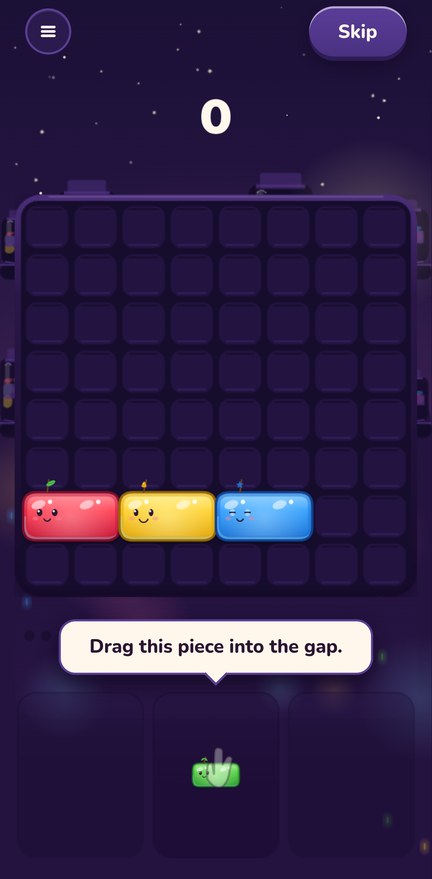
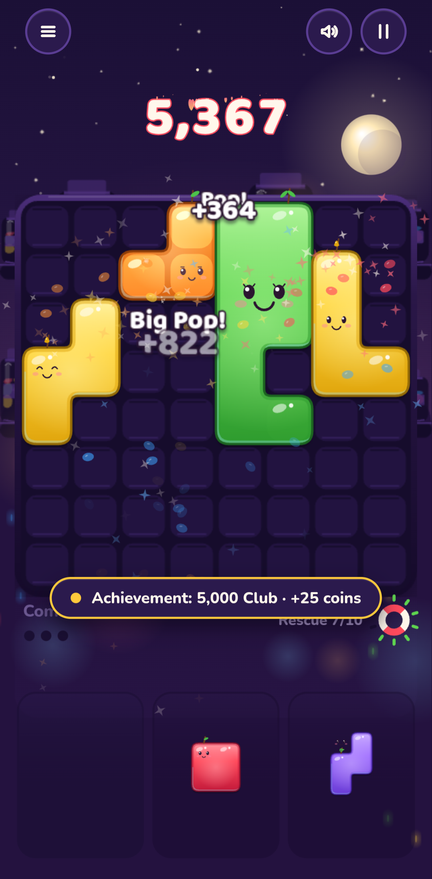
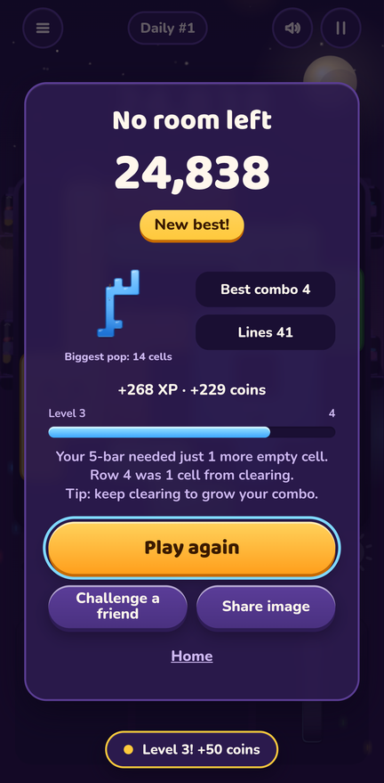
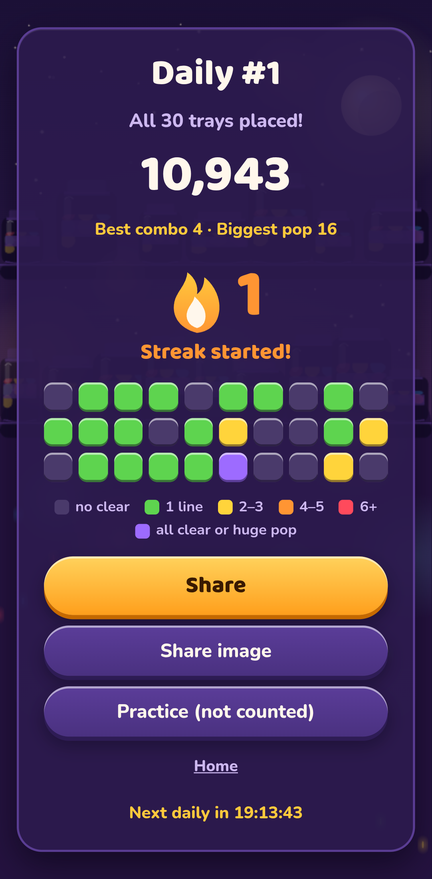
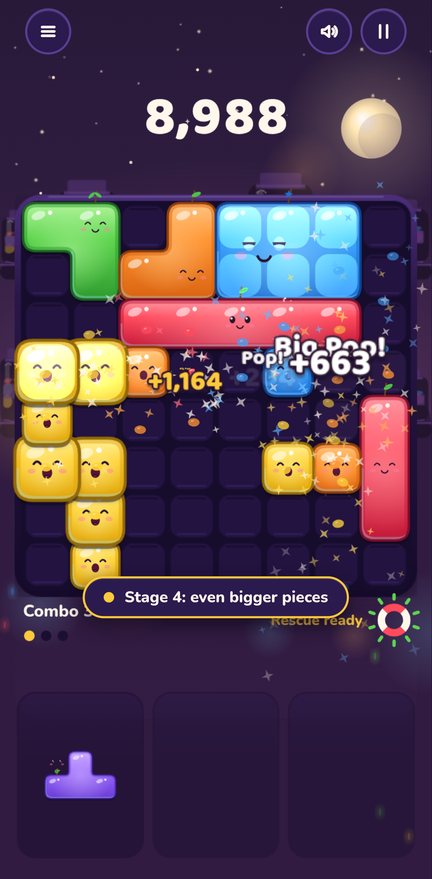
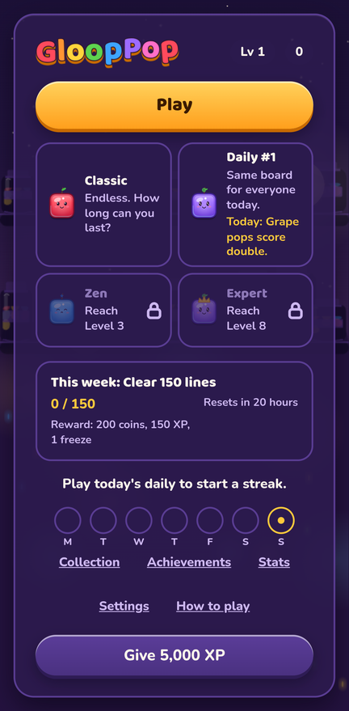
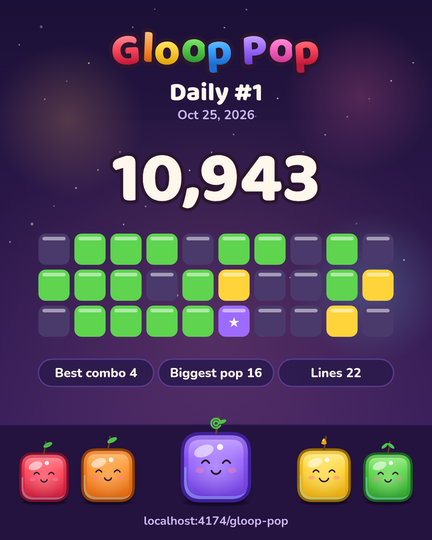
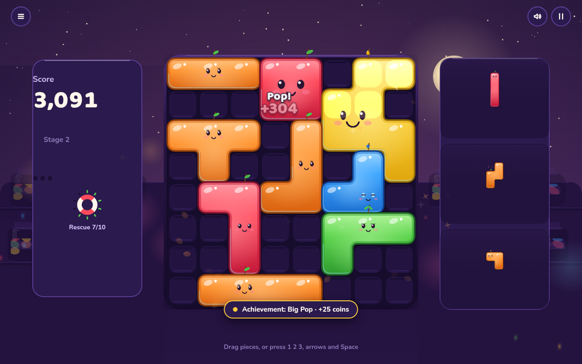

# Gloop Pop

Drag jelly blocks onto an 8×8 board to fill rows and columns. Same-colour jellies that touch join into one big gloop, and when you clear a line through any part of it, the whole gloop pops.

**Play:** https://aieatassam.github.io/gloop-pop/

It runs in any modern browser on a phone or a desktop. You don't need an install, an account or a connection after the first load. It has no ads and nothing to buy.

<p>
  
  
  
  
</p>

## How it plays

- You get three pieces at a time. Place all three to get new ones. Pieces don't rotate.
- Fill a row or a column to clear it. Two or more lines with one piece score a lot more.
- Same colours join into a gloop. Clear a line through it and the whole gloop pops: 8 cells make a Big Pop, 15 a Huge Pop, 24 a Mega Pop.
- Clear a line at least once every three pieces to keep your combo. The multiplier goes up to ×10.
- The run ends when none of your pieces fit. In Classic you can earn one rescue per run by clearing 10 lines.

## Modes

| Mode | What it is |
|---|---|
| Classic | Endless. The pieces get bigger as your score climbs. |
| Daily | The same board and the same 30 trays for everyone each day (UTC). Your first try counts toward your streak. Practice as often as you like after that. |
| Zen | No game over. When you get stuck, the two biggest gloops pop to make room. Unlocks at Level 3. |
| Expert | Bigger pieces and all 7 flavours from the start, no rescue, its own best score. Unlocks at Level 8. |

## Reasons to come back

- A daily puzzle with a numbered share grid you can paste into a group chat. It shows your run, not the answer.
- A streak with up to two freezes, which you earn by playing.
- A weekly goal that rotates every Monday.
- XP, levels, coins, 7 themes, 8 face skins, 6 pop effects and 41 achievements. Every item comes from play.
- "Challenge a friend" copies a link with your score. When your friend opens it, a bar tracks how close they are to beating you.

<p>
  
  
  
</p>



## Controls

Drag with a finger or the mouse. On a keyboard, press 1, 2 or 3 to pick a piece, move it with the arrow keys and press Space to place it. Esc pauses and M mutes.

## Build it yourself

```bash
npm ci
npm run dev        # local server
npm run check      # palette check, typecheck, lint, tests, build, bundle size
npm run sim -- --runs 100   # balance simulation with the bot
```

The stack is Vite, strict TypeScript, Canvas 2D and Vitest. Sound effects mix CC0 samples with WebAudio synthesis, and the music is a CC0 loop with synthesised layers. The audio files are about 0.8–1 MB, are loaded after your first tap, and are cached for offline play. The production bundle is about 65 KB of gzipped JavaScript. A service worker caches the game for offline play.

## Credits

Sound effects and music use free CC0 assets by Kenney, cbenci, JelloApocalypse, qubodup, Bertsz and omfgdude, from Kenney.nl, Freesound and OpenGameArt. The full list, with links, licences and the exact edits we made, is in [CREDITS.md](CREDITS.md). The game also shows it under Settings → Credits.

## Design documents

- [docs/design.md](docs/design.md): rules, scoring, modes, progression and every on-screen string
- [docs/art/style-guide.md](docs/art/style-guide.md): art direction, animation timings and sound recipes
- [docs/architecture.md](docs/architecture.md): code layout, state and save format
- [docs/research/virality.md](docs/research/virality.md): research into why small games spread, with sources
- [docs/milestones.md](docs/milestones.md): the build plan

## Deploying

Every push to `main` runs `.github/workflows/deploy.yml`. It runs `npm run check` and publishes `dist/` to GitHub Pages. If any check fails, nothing gets published.
